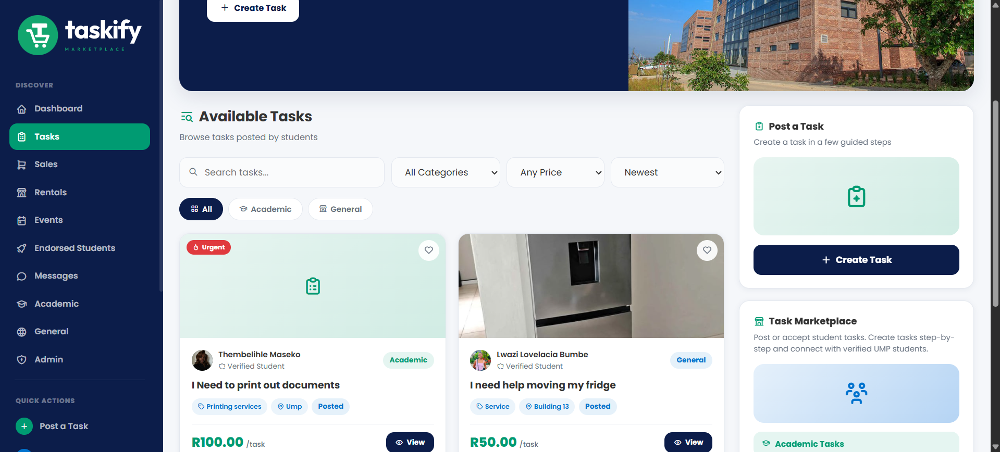
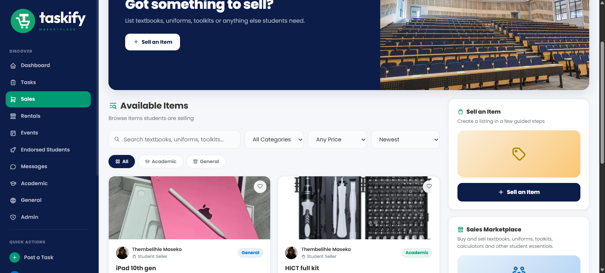
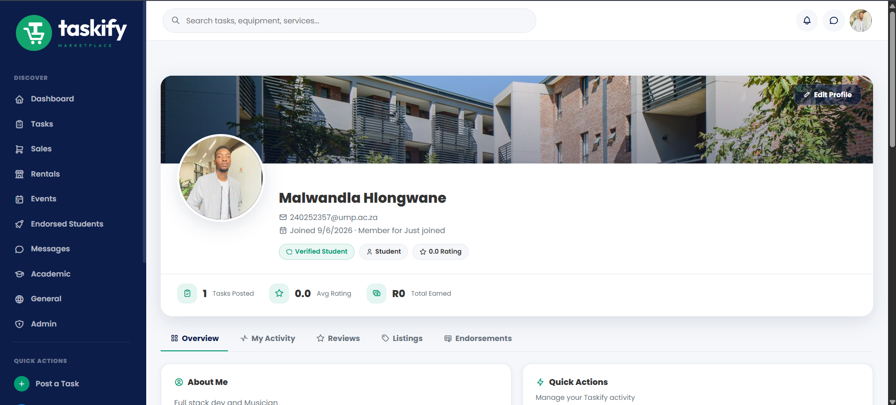
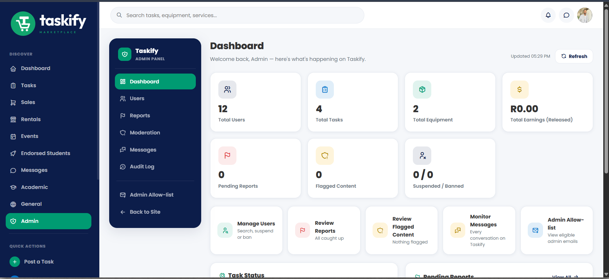

# Taskify | Campus Task & Equipment Marketplace

A full-stack marketplace for University of Mpumalanga students: post tasks, hire
other students, buy and sell items, and rent equipment, all inside a verified
campus community.

**Live site:** [taskify-marketplace.co.za](https://taskify-marketplace.co.za)




---

## What it does

| Area | What students can do |
|---|---|
| **Tasks** | Post academic or general tasks (printing, tutoring, moving a fridge), receive offers, negotiate, pick a worker and release payment when the job is done. |
| **Sales** | Sell textbooks, uniforms, toolkits and more. Protected sales use a one-time handover code that only the buyer receives, so the seller is paid only after a real meetup. |
| **Rentals** | Rent out equipment by the day, with date-clash checks, approve-then-pay, extensions, return deadlines, reminders and handling for overdue items. |
| **Events** | Browse campus events and see what's happening around campus. |
| **Messaging** | Chat about a listing. Contact details stay hidden until a payment is held. |
| **Lecturers** | Verified lecturers can endorse students. |
| **Admin panel** | Users, reports, content moderation, a full audit log, analytics with CSV exports, and an admin allow-list. |

<table>
  <tr>
    <td></td>
    <td></td>
  </tr>
  <tr>
    <td colspan="2"></td>
  </tr>
</table>

---

## Engineering highlights

- **No double bookings or duplicate payments.** Two students clicking "Rent" on
  the same item at the same second can't both get it. Rentals, sales and
  payment releases use row-level locks (`SELECT ... FOR UPDATE`) and
  conditional updates, so a double-click releases money only once.
- **26-table MySQL schema** with 39 foreign keys and 76 indexes. Schema changes
  ship as ordered repair scripts (`backend/scripts/repair-all.js`) that only add
  what's missing and never remove rows.
- **Server-side state machines** for tasks, sales and rentals. Every step
  checks who is acting and whether the move is allowed
  ([state-machines.md](docs/state-machines.md)).
- **Security:**
  - JWT authentication and bcrypt password hashing.
  - TOTP two-factor sign-in for admins, with the TOTP secrets stored encrypted.
  - Helmet security headers, rate limiting and login lockout.
  - Input validation with `express-validator`.
  - University-email-only registration.
  - Audit-logged admin actions.
  - CSV exports protected against formula injection.
- **AI content moderation** of posts and images through Azure AI Content
  Safety.
- **Notifications** by email (Brevo / Nodemailer) and web push, with a
  background scheduler for reminders.

---

## Tech stack

| Layer | Technology |
|---|---|
| Frontend | HTML, CSS, vanilla JavaScript (no framework), served as a static site |
| Backend | Node.js, Express 5, REST API with separate routes, controllers and services |
| Database | MySQL (`mysql2`), hosted on Aiven |
| Auth & security | JWT, bcrypt, otplib (TOTP), Helmet, express-rate-limit, express-validator |
| Services | Cloudinary (images), Brevo / Nodemailer (email), web-push, Azure AI Content Safety |
| Testing | Node.js built-in test runner |
| Hosting | Render (blueprint in `render.yaml`) |

## Project structure

```
backend/
  src/
    routes/        18 route files, one per area (tasks, sales, rentals...)
    controllers/   request handling
    services/      business rules and database access
    middleware/    auth, rate limiting, uploads, feature switches, errors
    jobs/          scheduler for reminders
  tests/           13 test suites
  scripts/         admin setup, schema export/import, repair scripts
frontend/          static pages, CSS and JS
docs/              state machines, money rules, ERD and data-flow diagrams
taskify-schema.sql full database structure for a fresh setup
```

---

## Tests

```bash
cd backend
npm test
```

**134 tests across 13 suites, all passing.** They cover:

- task, sale and rental workflows
- disputes
- simultaneous rental requests
- handover-code lockout
- registration rules
- admin-only access
- analytics exports

The test helper refuses to run against anything except a local database.

The suites are listed in the [improvement report](docs/improvement-report.md#7-tests).

---

## Running it locally

**You need:** Node.js 22+ and MySQL 8.

1. Create an empty database and load the structure:
   ```bash
   mysql -u root -p -e "CREATE DATABASE taskify"
   mysql -u root -p taskify < taskify-schema.sql
   ```
2. Configure and start the backend:
   ```bash
   cd backend
   cp .env.example .env    # fill in DB_* and JWT_SECRET at minimum
   npm install
   npm run dev             # API on http://127.0.0.1:5000
   ```
   Leave the email settings empty and emails are printed to the console
   instead of sent.
3. Serve the frontend:
   ```bash
   npx serve -l 5501 frontend
   ```
   Open http://localhost:5501. The frontend uses the local API automatically
   when it runs on localhost.
4. Create the first admin with `backend/scripts/create-admin.js` (usage is at
   the top of the file).

Deploying your own copy: see [DEPLOYMENT.md](DEPLOYMENT.md).

---

## Documentation

- [Improvement report](docs/improvement-report.md): architecture, changes, tests, limitations
- [State machines](docs/state-machines.md): how tasks, sales and rentals move step by step
- [Money rules](docs/money-rules.md): demo payments and feature switches
- [Diagrams](docs/diagrams/): ERD, data-flow diagrams (Level 0 and 1), state diagrams

## Limitations

- **Payments are a demo.** No real money moves until a payment provider is
  connected ([open-questions.md](docs/open-questions.md)).
- **The frontend has no automated browser tests.**

---

## Author

**Malwandla Hlongwane**, final-year Diploma in ICT (Applications Development),
University of Mpumalanga

[Portfolio](https://malwandla21-ict.github.io/MH-Profile/) ·
[LinkedIn](https://www.linkedin.com/in/malwandla-hlongwane-8484603a3) ·
MalwandlaHlongwaneICT@outlook.com
